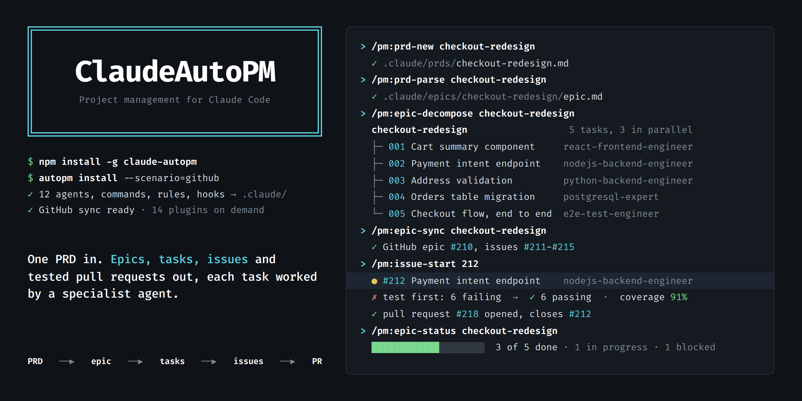
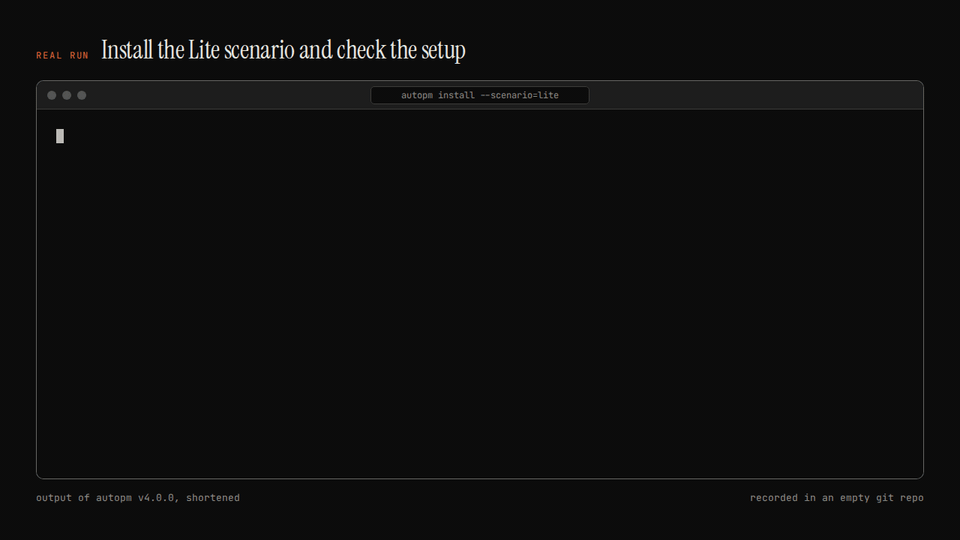
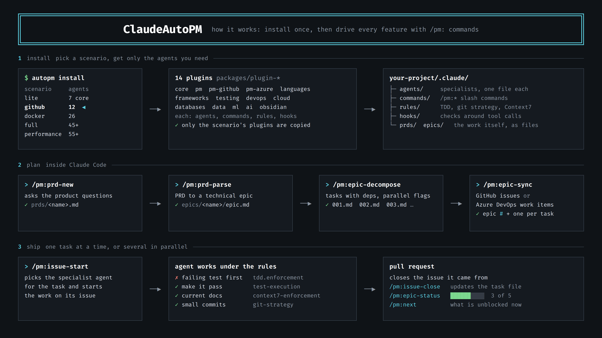
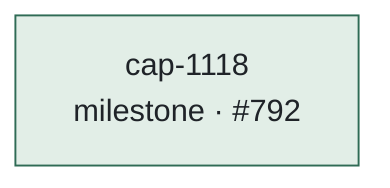

<p align="center"><a href="https://www.npmjs.com/package/claude-autopm"><picture>
  <source media="(prefers-color-scheme: light)" srcset="docs/images/banner-light.png">
  
</picture></a></p>

<p align="center"><b>From PRD to epics to shipped issues, run by specialist Claude Code agents.</b><br>
<a href="#quick-install">Install</a> · <a href="#demo">Demo</a> · <a href="#how-it-works">How it works</a> · <a href="docs-site/docs">Docs</a></p>

<p align="center">
<a href="https://www.npmjs.com/package/claude-autopm"></a>
<a href="LICENSE"></a>


<a href="https://github.com/lagowski/ClaudeAutoPM"></a>
</p>

# ClaudeAutoPM

**AI-Powered Project Management Framework for Claude Code**

ClaudeAutoPM transforms your development workflow with intelligent automation, specialized AI agents via a plugin system, and complete GitHub/Azure DevOps integration. Install only what you need — pay only for the tokens you use.

## Demo

<p align="center"></p>

<sub>A real run of autopm v4.0.0 in an empty git repository, output shortened.</sub>

## How it works

<p align="center"></p>

`autopm install` copies the framework and the plugins your scenario picks into `.claude/`. Slash commands turn a PRD
into epics and tasks and sync them to GitHub or Azure DevOps; agents then work each task under the XML rules (tests
first, coverage gates) and close it with a pull request.

---

## Quick Install

Requires Node.js >= 22 and npm >= 10.

```bash
npm install -g claude-autopm
cd your-project
autopm install
```

Without a global install: `npx -p claude-autopm autopm install --scenario=lite` (the command is `autopm`, so npx needs `-p`).

Choose your scenario during installation:

| Scenario | Agents | Use case |
|----------|--------|----------|
| **Lite** | 7 core | Local PM only, minimal token footprint |
| **GitHub** | 12 | Core + languages for GitHub projects |
| **Azure** | 12 | Core + languages + Azure DevOps sync |
| **Docker** | 26 | Core + languages + frameworks + testing + DevOps |
| **Obsidian** | 7 core | PM + Obsidian vault integration |
| **Full** | 45+ | Complete CI/CD: cloud, databases, AI included |
| **Performance** | 55+ | All plugins (incl. data + ML) + max parallelization |

Skip the prompt with `autopm install --scenario=<name>` (`lite`, `github`, `azure`, `docker`, `full`, `full-azure`, `performance`, `obsidian`); `full-azure` is Full plus Azure DevOps sync.

---

## Architecture

### Plugin-Based Agent System

ClaudeAutoPM uses a **plugin architecture** for token efficiency. Only 7 core agents are loaded by default. Specialized agents are installed on demand via plugins.

```
autopm/.claude/agents/       ← 7 core agents (always available)
packages/plugin-*/agents/    ← 50+ specialized agents (per plugin)
```

These are repo paths. In an installed project, agents live in `.claude/agents/`.

**Token savings**: Lite installs use 73% fewer agent tokens vs full.

### XML Rules Engine

8 critical rules auto-loaded via `@include` in XML format:

| Rule | Enforcement |
|------|-------------|
| `tdd.enforcement.xml` | Zero-tolerance TDD cycle |
| `coverage-thresholds.xml` | 80/75/80/80 coverage gates |
| `agent-mandatory.xml` | Agent delegation + context strategy |
| `context7.xml` | Context7 MCP before any library code |
| `github-operations.xml` | Repo protection + mandatory issue footer |
| `naming-conventions.xml` | Naming prohibitions + code quality |
| `command-pipelines.xml` | 5 mandatory command sequences |
| `issue-structure.xml` | Standard GitHub issue structure (goal, criteria, verification) |

3 MD operational guides: `standard-patterns.md`, `frontmatter-operations.md`, `git-strategy.md`

### Dynamic Agent Registry

`agent-registry.xml` is generated at install time based on selected plugins:

```xml
<!-- Core agents (always present) -->
<agents category="core">
  <agent name="code-analyzer">...</agent>
  <agent name="test-runner">...</agent>
  ...
</agents>

<!-- Plugin agents (injected by installer) -->
<!-- PLUGIN_AGENTS_START -->
<agents category="languages">...</agents>
<agents category="frameworks">...</agents>
<!-- PLUGIN_AGENTS_END -->
```

---

## Core Agents (Always Available)

| Agent | Purpose |
|-------|---------|
| `agent-manager` | Agent lifecycle, registry maintenance |
| `code-analyzer` | Code analysis, bug detection, logic tracing |
| `test-runner` | Test execution with actionable insights |
| `file-analyzer` | Summarize large files, reduce context |
| `parallel-worker` | Multi-agent parallel work streams |
| `mcp-manager` | MCP server install, config, health |
| `context-optimizer` | Context window efficiency, compaction |

## Plugin Agents

| Plugin | Agents | Examples |
|--------|--------|----------|
| **plugin-languages** | 5 | python-backend-engineer, nodejs-backend-engineer, bash-scripting-expert |
| **plugin-frameworks** | 6 | react-frontend-engineer, tailwindcss-expert, e2e-test-engineer |
| **plugin-cloud** | 8 | aws-cloud-architect, kubernetes-orchestrator, terraform-infrastructure-expert |
| **plugin-devops** | 7 | docker-containerization-expert, github-operations-specialist, observability-engineer |
| **plugin-databases** | 5 | postgresql-expert, mongodb-expert, redis-expert |
| **plugin-ai** | 8 | openai-python-expert, gemini-api-expert, langchain-expert |
| **plugin-data** | 3 | airflow-orchestration-expert, kedro-pipeline-expert |
| **plugin-testing** | 1 | frontend-testing-engineer |
| **plugin-ml** | 10 | pytorch-expert, tensorflow-keras-expert, scikit-learn-expert |
| **plugin-pm** | — | 29 PM commands (PRD, epic, issue management) |

---

## Quick Start

All commands run inside Claude Code (not terminal):

```bash
# Initialize context and testing
/context:create
/test:test-setup

# PM workflow
/pm:issue-start 42
/pm:issue-close 42

# Working with agents
@python-backend-engineer Build FastAPI endpoint
@test-runner execute all tests
@code-analyzer review recent changes
```

---

## Features

### 14 Official Plugins

- **Core** — Context management, testing, configuration, MCP
- **PM System** — PRD, epics, issues, decomposition, git workflow
- **Obsidian** — Read-only vault sync, Dataview frontmatter, diagnostics
- **Azure DevOps** — Work items, boards, pipelines, sprints
- **GitHub** — Workflows, issues, PRs, automation
- **Languages** — Python, JavaScript, Node.js, Bash
- **Frameworks** — React, Tailwind, UX, E2E testing, NATS
- **Testing** — Frontend unit/integration, E2E
- **DevOps** — Docker, Kubernetes, Traefik, SSH, observability
- **Cloud** — AWS, Azure, GCP, Terraform, serverless
- **Databases** — PostgreSQL, MongoDB, BigQuery, CosmosDB, Redis
- **AI** — OpenAI, Gemini, Claude, LangChain, HuggingFace
- **ML** — PyTorch, TensorFlow/Keras, scikit-learn, AutoML
- **Data** — Airflow, Kedro, LangGraph

### Provider Integration

- **GitHub** — Issues, PRs, Actions, Projects
- **Azure DevOps** — Work Items, Boards, Pipelines
- **Local** — Git-based workflow with markdown tracking

### Execution Strategies

- **Sequential** — Safe, predictable
- **Adaptive** — Intelligent mode selection (default)
- **Hybrid** — Maximum parallelization

---

## Documentation

- [Installation](https://lagowski.github.io/ClaudeAutoPM/getting-started/installation)
- [Command Overview](https://lagowski.github.io/ClaudeAutoPM/user-guide/commands-overview)
- [Agent Registry](https://lagowski.github.io/ClaudeAutoPM/user-guide/agents-overview)
- [Plugin Development](https://lagowski.github.io/ClaudeAutoPM/developer-guide/plugin-development)
- [Architecture](https://lagowski.github.io/ClaudeAutoPM/developer-guide/architecture)

---

## Why ClaudeAutoPM?

| Feature | ClaudeAutoPM | Traditional Tools |
|---------|--------------|-------------------|
| AI-native | Built for Claude Code | Adapted/retrofitted |
| Token-efficient | Plugin system, install what you need | Monolithic |
| Agents | 50+ specialized, load on demand | Generic or none |
| Rules | 8 XML auto-enforced (TDD, coverage, Context7) | Manual checklists |
| Integration | GitHub + Azure DevOps | Limited |
| Documentation | Context7-verified, always current | Often outdated |

---

## Contributing

We welcome contributions! See [Contributing Guide](https://lagowski.github.io/ClaudeAutoPM/developer-guide/contributing).

TDD is mandatory — every PR must follow Red-Green-Refactor.

---

## License

MIT License - see [LICENSE](LICENSE) for details.

---

## Links

- **Documentation**: [lagowski.github.io/ClaudeAutoPM](https://lagowski.github.io/ClaudeAutoPM/)
- **npm**: [npmjs.com/package/claude-autopm](https://www.npmjs.com/package/claude-autopm)
- **Issues**: [GitHub Issues](https://github.com/lagowski/ClaudeAutoPM/issues)
- **Changelog**: [CHANGELOG.md](CHANGELOG.md)

<!-- veracrew:delivery:start -->
## What has been delivered

_Generated by VeraCrew from its walk records for `lagowski/ClaudeAutoPM` on every promotion (#2169). Edits between these markers are overwritten._



| run | promoted | items delivered |
|---|---|---|
| cap-1118 (milestone) | 2026-11-18 | #792 Subagents inherit Opus: default agent definitions to Sonnet, Opus only where named |
<!-- veracrew:delivery:end -->
